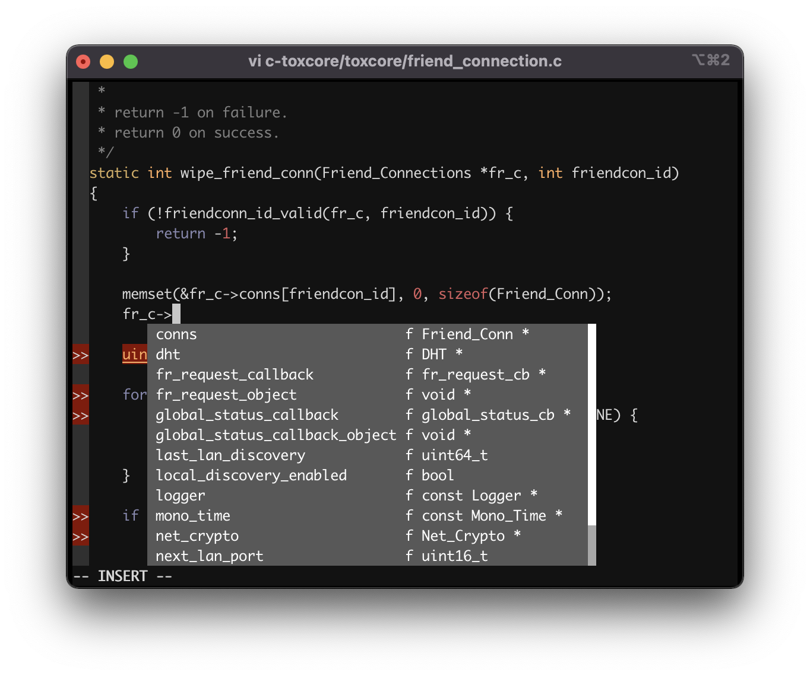

# TokTok stack

This repository contains git submodules for all directly supported Tox-related
repositories. This ensures that any changes made to any of the submodules are
always compatible in the snapshot taken by toktok-stack. Before a toxcore
release, toktok-stack must cleanly build with the latest `master` commit in
`c-toxcore`. Clients, bindings, and support programs must always pass all tests
in this snapshot. We don't guarantee security of the snapshot, merely
interoperability, so don't rely on the security or even error-freeness of
anything here. If you need that, use released versions of the submodules
themselves.

## Tox Clients

|                   | [qTox]               | [toxic]               | [bTox]                 | [hTox]                | [toxxi]             | [Go Tox] | [PyTox]      | [kTox]          |
| ----------------- | -------------------- | --------------------- | ---------------------- | --------------------- | ------------------- | -------- | ------------ | --------------- |
| Written in        | C++, Qt              | C, ncurses            | Dart, Flutter          | Haskell, Hatter       | Rust, ratatui       | Go, Gio  | Python, Kivy | Kotlin, Compose |
| **Platforms**     |                      |                       |                        |                       |                     |          |              |                 |
| Linux             | ✓                    | ✓                     | ✓                      | ✓                     | ✓                   | ✓        | ✓            | ✓               |
| Windows           | ✓                    | ✗                     | ✓                      | ✗                     | ✗                   | ✗        | ✗            | ✗               |
| macOS             | ✓                    | ✓                     | ✓                      | ✗                     | ✗                   | ✗        | ✗            | ✗               |
| Android           | ✓                    | ✓                     | ✓                      | ✓                     | ✗                   | ✓        | ✓            | ✓               |
| iOS               | ✗                    | ✗                     | ✓                      | ✗                     | ✗                   | ✗        | ✗            | ✗               |
| Web               | ✓                    | ✗                     | ✓                      | ✓                     | ✗                   | ✗        | ✗            | ✗               |
| Terminal          | ✗                    | ✓                     | ✗                      | ✓                     | ✓                   | ✗        | ✗            | ✗               |
| **Features**      |                      |                       |                        |                       |                     |          |              |                 |
| Messages, history | ✓                    | history if logging on | ✓                      | ✓                     | ✓                   | ✓        | ✓            | ✓               |
| Replies           | quotes selected text | ✗                     | ✓                      | ✓                     | ✗                   | ✗        | ✗            | ✗               |
| Links open        | ✓                    | by the terminal       | ✓                      | from the message menu | by the terminal     | ✗        | ✗            | ✗               |
| Groups (NGC)      | ✓                    | ✓                     | ✓                      | ✓                     | ✓                   | ✓        | ✓            | ✓               |
| Conferences       | ✓                    | ✓                     | through a linked toxxi | text only             | ✓                   | ✓        | ✗            | ✗               |
| File transfers    | ✓                    | ✓                     | not on web             | ✓                     | ✓                   | ✓        | ✓            | ✓               |
| Avatars           | ✓                    | send only             | ✓                      | ✓                     | for linked devices  | ✓        | ✓            | ✓               |
| Audio calls       | ✓                    | ✓                     | not on web             | not in the terminal   | for linked devices  | ✓        | ✓            | ✓               |
| Video calls       | ✓                    | ✓                     | not on web             | not in the terminal   | for linked devices  | ✓        | ✓            | ✓               |
| Conference calls  | ✓                    | ✓                     | ✗                      | ✗                     | ✗                   | ✗        | ✗            | ✗               |
| Notifications     | ✓                    | not on Android        | Android only           | not on web            | ✗                   | ✓        | ✓            | Android only    |
| Encrypted storage | ✓                    | profile, not logs     | not on web             | not on web            | ✗                   | ✓        | ✗            | ✗               |
| Several profiles  | ✓                    | one per run           | ✓                      | ✓                     | one per run         | ✓        | ✓            | ✓               |
| Linked devices    | ✗                    | ✗                     | ✓                      | ✓                     | ✓ (the home device) | ✗        | ✗            | ✗               |

[qtox]: qtox
[toxic]: toxic
[btox]: btox
[htox]: htox
[toxxi]: rs-toxcore-c/toxxi
[go tox]: go-toxcore-c/apps/client
[pytox]: py_toxcore_c/apps/client
[ktox]: jvm-toxcore-c/apps/client

## Android clients

The Android apps on our bindings should be roughly the same to use. This table
shows where they differ; what they all have or all lack is listed under it.

|                            | [hTox]                              | [bTox]                              | [kTox]             | [Go Tox]           | [PyTox]               |
| -------------------------- | ----------------------------------- | ----------------------------------- | ------------------ | ------------------ | --------------------- |
| **Chats**                  |                                     |                                     |                    |                    |                       |
| Away/busy in the list      | ✗                                   | ✗                                   | ✓                  | ✓                  | ✓                     |
| Set own away/busy          | ✓                                   | ✗                                   | ✓                  | ✓                  | ✓                     |
| Friend nicknames           | ✗                                   | ✗                                   | ✗                  | ✓                  | ✗                     |
| Mute a chat                | ✓                                   | ✓                                   | ✗                  | ✗                  | ✗                     |
| **Messages**               |                                     |                                     |                    |                    |                       |
| /me actions                | receive only                        | ✓                                   | ✓                  | ✓                  | ✓                     |
| Delivery marks             | waiting, sent, delivered            | waiting, sent, delivered            | waiting, delivered | waiting, delivered | waiting, delivered    |
| Time shown                 | last of a run                       | last of a run                       | last of a run      | every message      | every message         |
| Replies                    | ✓                                   | ✓                                   | ✗                  | ✗                  | ✗                     |
| Forward                    | to friends                          | ✓                                   | ✗                  | ✗                  | ✗                     |
| Copy                       | ✓                                   | ✓                                   | text selection     | ✗                  | text selection        |
| Select several             | ✓                                   | ✓                                   | ✗                  | ✗                  | ✗                     |
| Message info               | ✓                                   | ✓                                   | ✗                  | ✗                  | ✗                     |
| Links open                 | from the message menu               | ✓                                   | ✗                  | ✗                  | ✗                     |
| Big emoji-only messages    | friends only                        | one emoji only                      | ✗                  | ✗                  | ✗                     |
| Drafts kept                | ✓                                   | ✓                                   | ✗                  | ✗                  | until it closes       |
| **Files**                  |                                     |                                     |                    |                    |                       |
| Send files                 | friends and groups                  | friends only                        | friends only       | friends only       | friends only          |
| Receive files              | ask, or auto by size                | auto up to 4 MB                     | ask                | ask                | ask                   |
| Pause transfers            | group downloads                     | ✗                                   | ✗                  | ✓                  | ✗                     |
| Received files             | open                                | open                                | save, open         | save               | save, open            |
| Picture from the camera    | ✓                                   | ✓                                   | ✗                  | ✗                  | ✗                     |
| **Groups**                 |                                     |                                     |                    |                    |                       |
| Private messages           | ✓                                   | ✓                                   | receive only       | ✓                  | receive only          |
| Ignore a peer              | ✗                                   | ✗                                   | ✗                  | ✓                  | ✗                     |
| Conferences                | text only                           | through a linked toxxi              | ✗                  | text only          | ✗                     |
| Notifications              | all, or mentions                    | all, or mentions                    | mentions, private  | mentions           | all                   |
| **Calls**                  |                                     |                                     |                    |                    |                       |
| Rings over the lock screen | ✓                                   | ✓                                   | ✓                  | in the app only    | ✓                     |
| Audio output               | earpiece, speaker, wired, Bluetooth | earpiece, speaker, wired, Bluetooth | earpiece, speaker  | speaker only       | earpiece, speaker     |
| Switch camera              | ✓                                   | ✓                                   | ✓                  | front only         | ✓                     |
| Calls tab                  | ✓                                   | ✓                                   | ✗                  | ✗                  | ✗                     |
| **Network**                |                                     |                                     |                    |                    |                       |
| Proxy                      | ✓                                   | ✓                                   | ✗                  | ✓                  | ✗                     |
| Own bootstrap nodes        | ✗                                   | ✗                                   | ✗                  | ✓                  | ✗                     |
| **Profiles**               |                                     |                                     |                    |                    |                       |
| Encrypted storage          | key in the keystore                 | key in the keystore                 | ✗                  | password           | ✗                     |
| Several profiles           | all online at once                  | all online at once                  | all online at once | all online at once | all online at once    |
| Export, import             | ✓                                   | encrypted backups                   | ✗                  | .tox files         | ✗                     |
| Delete a profile           | ✓                                   | ✓                                   | ✓                  | ✓                  | ✓                     |
| **Look**                   |                                     |                                     |                    |                    |                       |
| Theme                      | follows the system                  | dark only                           | follows the system | light or dark      | system, light or dark |
| Wallpaper colours          | ✗                                   | ✗                                   | ✓                  | ✗                  | ✗                     |
| Languages                  | English                             | 16                                  | English            | English            | English               |
| Text size                  | ✗                                   | ✗                                   | ✗                  | ✓                  | ✗                     |
| **Formats and sync**       |                                     |                                     |                    |                    |                       |
| Linked devices (toxsync)   | ✓                                   | ✓                                   | ✗                  | ✗                  | ✗                     |
| Tox.Share files            | in groups                           | ✗                                   | ✗                  | ✗                  | ✗                     |
| Locations                  | friends only                        | ✓                                   | ✗                  | ✗                  | ✗                     |
| Relay-bot names            | ✓                                   | ✓                                   | ✗                  | ✗                  | ✗                     |
| Hide after a zero byte     | ✓                                   | ✓                                   | ✗                  | ✗                  | ✓                     |
| Pictures sent as QOI       | ✓                                   | ✓                                   | ✗                  | ✗                  | ✗                     |

All five have: friends and groups in one chat list with unread counts and
previews, adding friends by Tox ID, their own QR code, friend requests, their
own name, status message and avatar, day headings, older history loaded while
scrolling, long messages split to fit, typing in friend chats, pictures shown
in the chat, file transfers that go on after reconnecting, NGC groups (create,
join, invite, peers, roles, topic, leave), audio and video calls with notes in
the chat, notifications that open the chat, staying connected in the
background and starting at boot, UDP, IPv6 and LAN discovery switches, and
built-in bootstrap nodes.

None has yet: searching chats or messages, scanning QR codes, sharing the Tox
ID through Android's share sheet, blocking friends, deleting messages, sharing
into the app from other apps, and replying from a notification.

hTox also has a debug screen and runs on either Tox library (hs-toxcore or
c-toxcore), which the others don't need.

## Dev Containers



See [dev containers](tools/built/dev) for details.

## Downloading

To download the TokTok stack, use `git`:

```sh
git clone --recursive https://github.com/TokTok/toktok-stack
```

## Configuring

You may pass a compiler config for additional compiler-specific warnings and
optimisations. If you use Clang (default on OSX), pass `--config=clang`. If you
use GCC, pass `--config=gcc`. On Windows, you don't need any compiler flag
because we assume it's MSVC.

There are also `--config=release` and `--config=debug` and more. See `.bazelrc`
in this repository for more config flags you can pass. If you're using the
Docker build, then `--config=asan`, `tsan`, and `msan` are also available.

We recommend copying `.bazelrc.local.example` to `.bazelrc.local` and
customising it according to the comments in that file.

## Building

After installing prerequisites (instructions below), run the following command
in the `toktok-stack` directory:

```sh
bazel build //...
```

### Installing prerequisites

To build the stack, first you need to install some software. This guide assumes
an installation of Debian GNU/Linux version 9 and that you are in the
`toktok-stack` directory. There is partial support for macOS and FreeBSD, but
not all targets can be built on those systems.

#### Bazel

Install the latest version of
[Bazel](https://github.com/bazelbuild/bazel/releases), e.g.:

```sh
wget https://github.com/bazelbuild/bazel/releases/download/4.2.1/bazel_4.2.1-linux-x86_64.deb
sudo dpkg -i bazel_4.2.1-linux-x86_64.deb
```

On OSX:

```sh
brew install bazel
```

On FreeBSD:

```sh
sudo pkg install bazel
```

On Windows:

```sh
choco install bazel
```

#### Qt5

To build Qt-based binaries such as `qtox`, you need an installation of Qt
development headers and libraries and tools.

```sh
sudo apt install qttools5-dev qttools5-dev-tools libqt5svg5-dev
```

On OSX:

```sh
brew install qt
```

On FreeBSD:

```sh
sudo pkg install qt5
```

On Windows:

```sh
choco install qt
```

If your Qt installation doesn't live in a standard location, make changes to the
detector script in `tools/workspace/qt.bzl` and consider sending us a pull
request. If your version of Qt is different, edit `WORKSPACE` and adjust it in
the `qt_repository` declaration.

#### Extra development packages

Some libraries have not yet been imported into `third_party`, so must be
installed on the system.

For `//qtox`:

```sh
sudo apt install libasound2-dev libxss-dev
```

For `//toxic`:

```sh
sudo apt install libxss-dev
```

On OSX (for both `qtox` and `toxic`):

```sh
brew install ncurses
```

On FreeBSD:

```sh
sudo pkg install ncurses
```

Note that toxic also needs Python 3. See the section on Python for how to
install its development files.

#### Python

To build `py-toxcore-c` and other programs using Python FFI, you need Python
development headers. `py-toxcore-c` and `toxic` both need Python 3. Any of 3.5,
3.6, or 3.7 works.

```sh
sudo apt install python3.5-dev
```

On FreeBSD:

```sh
sudo pkg install python3
```

#### Native javacpp libraries

Streambot needs native libraries that need to be downloaded from Maven.

```sh
wget https://repo1.maven.org/maven2/org/bytedeco/javacpp-presets/ffmpeg/3.4.1-1.4/ffmpeg-3.4.1-1.4-linux-x86_64.jar -O third_party/javacpp/ffmpeg/jar/ffmpeg-3.4.1-1.4-linux-x86_64.jar
wget https://repo1.maven.org/maven2/org/bytedeco/javacpp-presets/opencv/3.4.0-1.4/opencv-3.4.0-1.4-linux-x86_64.jar -O third_party/javacpp/opencv/jar/opencv-3.4.0-1.4-linux-x86_64.jar
```

## Troubleshooting

### Xcode version must be specified to use an Apple CROSSTOOL

Try running the following:

```sh
sudo xcode-select -s /Applications/Xcode.app/Contents/Developer
sudo xcodebuild -license
bazel clean --expunge
```

See
[this](https://github.com/bazelbuild/bazel/issues/4314#issuecomment-370172472)
GitHub comment or [this](https://stackoverflow.com/a/46460129) stackoverflow
answer for more details.
